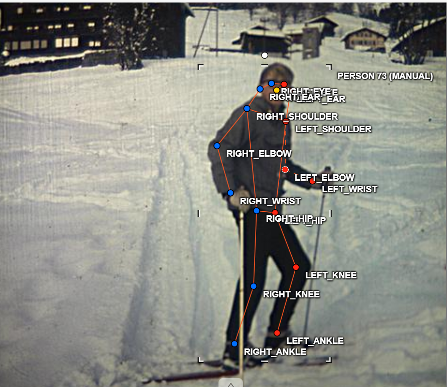
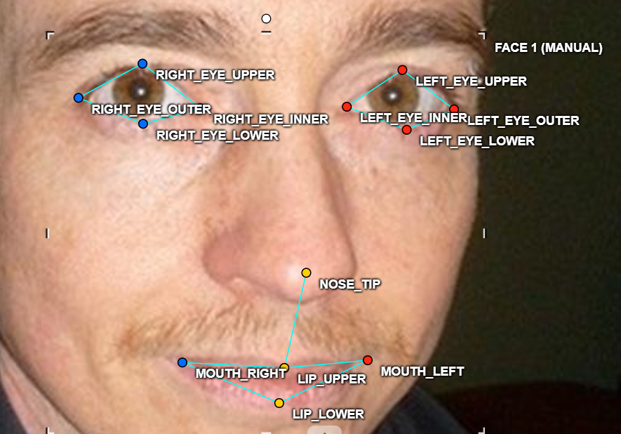
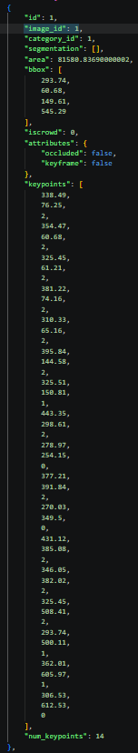

# Báo cáo cá nhân — DaoDuyHieu - 2A202603235

## 0. Thông tin học viên

- Họ tên: Đào Duy Hiếu
- MSSV: 2A202603235
- Email: 26ai.hieudd2@vinuni.edu.vn
- Link repository: https://github.com/HIEU2460/K5-L2-DAY04-DaoDuyHieu-2A202603235-KeypointPose
- Phiên bản CVAT (Help → About): CVAT v2.74.1
- Máy: Windows 11 - RAM 8 GB
- Bộ ảnh (`src/exports/assignment.json` do `lab.py setup` tạo): có
- Giờ bắt đầu: 16:45
- Giờ kết thúc: 19:30

## 1. Kiểm tra label (CP0)

| Label | Kiểu | Số điểm | Tên điểm đúng bảng của lab? | Đúng thứ tự? | Số cạnh |
|---|---|---:|---|---|---:|
| `person` | Skeleton | 17 | Có | Có | 19 |
| `face` | Skeleton | 13 | Có | Có | 13 |

Mẫu `person` dựng theo người quay mặt về camera (các điểm `left_*` nằm bên phải khung mẫu)? Trả lời: Có

Cách đổi cờ `occluded` / `outside` cho **một điểm** trên phiên bản CVAT này (một câu):
Trả lời: Chọn đúng điểm con trong Skeleton, sau đó sử dụng thao tác Occluded hoặc Outside tương ứng, kiểm tra trạng thái của điểm và lưu annotation.

## 2. Số lượng đã gán và thời gian (CP1, CP2)

| Nhóm ảnh | Số ảnh | Số skeleton đã gán | Số người dưới 60 px (không gán) | Số poster / gương / màn hình bỏ qua | Thời gian (phút) |
|---|---:|---:|---:|---:|---:|
| `easy` | 5 | 5 | 0 | 0 | 90 |
| `occluded` | 3 | 6 | 0 | 0 | 30 |
| `back` | 2 | 3 | 0 | 0 | 30 |
| `small` | 1 | 2 | 7 | 0 | 30 |
| `crowd` | 1 | 3 | 0 | 0 | 0 |
| `faces` | 8 | 8 | — | 0 | 30 |

- Số ảnh người đã xong ở mốc phút 105: 4 / 12
- Thời gian thực tế (phút): CP1 ___ · CP2 ___ · CP3 ___
- Ảnh tốn thời gian nhất là ảnh nào, vì sao?
Trả lời: ảnh tốn thời gian nhất là ảnh 000000572411.jpg, vì có nhiều người cùng chung 1 ảnh, những người trong ảnh ngồi xa khiến hình bị mờ và ngồi với tư thế khó có thể gán.

## 3. Bảng ca khó (CP1, CP2)

| Ảnh | Người / mặt | Điểm | Cờ đã chọn | Phân vân giữa | Lý do chọn |
|---|---|---|---:|---|---|
| 000000030960.jpg | Người #2 | `left_ankle` | `v = 0` | `v = 0` / `v = 2` | Điểm nằm ngoài ảnh nên chuyển sang `outside`. |
| face_294580.jpg | Mặt #1 | `eye_upper`, `eye_lower` | `v = 1` | `v = 1` / `v = 0` | Kính che vùng mắt, cần đánh giá khả năng xác định vị trí mí mắt. |
| 000000332273.jpg | Người #3 | `left_ankle`, `right_ankle` | `v = 2` | Trái / phải | Tư thế chân khiến việc phân biệt trái và phải khó hơn. |

## 4. Bảng tự review (CP3)

Đi từ ảnh cuối về ảnh đầu. 5 ảnh người (ít nhất 2 ảnh `back` hoặc `crowd`) và 3 ảnh mặt. Ít nhất 8 dòng, kể cả dòng `ok`. Ghi lỗi trước, sửa sau.

Mã lỗi dùng đúng một trong: `lr_swap`, `vis_flag`, `position`, `missing`, `extra`, `ok`.

| Ảnh | Người / mặt | Điểm | Mã lỗi | Ghi chú | Đã sửa? |
|---|---|---|---|---|---|
| 000000030960.jpg | Người #2 | left_ankle | vis_flag | Điểm nằm ngoài ảnh nhưng đang để v=2. | Có |
| 000000572411.jpg | Người #3 | Skeleton | extra | Kiểm tra người nhỏ dưới 60 px. | Có |
| 000000147780.jpg | Người #1 | Toàn bộ skeleton | ok | Kiểm tra đủ 17 điểm, thứ tự trái/phải và cờ visibility sau khi xuất. | Không cần |
| 000000332273.jpg | Người #3 | ankle | lr_swap | Kiểm tra hướng trái/phải của chân. | Đã điều chỉnh |
| 000000360811.jpg | Người #1, #2 | Tay và hông | ok | Hai người ngồi sau bàn, phần thân dưới bị che; các điểm ngoài vùng nhìn thấy cần kiểm tra lại. | Không cần |
| face_294580.jpg | Mặt #1 | 8 điểm mắt | ok | Các điểm mắt được đặt quanh mí và khóe mắt, nhìn tương đối đúng vị trí. | Không cần |
| face_380639.jpg | Mặt #1 | 8 điểm mắt | ok | Người cúi đầu, mắt nhìn xuống; cần chú ý vị trí mí trên và mí dưới. | Không cần |
| face_145751.jpg | Mặt #1 | 13 điểm mặt | ok | Kiểm tra đủ 13 điểm, vị trí mí mắt, khóe mắt, mũi và khóe miệng. | Không cần |

Tổng hợp số lỗi theo mã:

| `lr_swap` | `vis_flag` | `position` | `missing` | `extra` | `ok` |
|---:|---:|---:|---:|---:|---:|
| 1 | 2 | 0 | 0 | 2 | 3 |

Điểm còn phân vân giữa `v = 1` và `v = 0` (ghi cả hai lựa chọn và lý do chọn):

Trả lời: Tôi phân vân ở các điểm mắt bị kính râm che và các khớp cơ thể bị vật khác che khuất, như người đứng sau ngựa.
v = 1: Điểm bị che nhưng vẫn có thể ước lượng được vị trí tương đối chính xác.
v = 0: Điểm bị che hoàn toàn hoặc nằm ngoài ảnh, không thể xác định vị trí đáng tin cậy.
Tôi chọn `v = 1` khi có đủ cơ sở xác định vị trí điểm dựa vào tư thế cơ thể hoặc cấu trúc khuôn mặt. Nếu không thể xác định chắc chắn, tôi chọn `v = 0` để tránh tạo nhãn sai cho mô hình.

## 5. Kiểm file xuất và kết quả tự kiểm (CP4)

**Tự kiểm tay trong file JSON:**

| File                     | Người / mặt kiểm (ảnh, thứ tự) | Số phần tử `keypoints` | Điểm `outside` ra `v = 0`, `occluded` ra `v = 1`? | `num_keypoints` khớp? |
| ------------------------ | ------------------------------ | ---------------------- | ------------------------------------------------- | --------------------- |
| `DaoDuyHieu_persons.zip` | `000000030960.jpg`, người #2 | 51 | Có, `outside` => `v = 0`; không có điểm `occluded` | Có (`15 = 15`) |
| `DaoDuyHieu_persons.zip` | `000000147780.jpg`, người #1 | 51 | Có, `outside` => `v = 0`, `occluded` → `v = 1` | Có (`15 = 15`) |
| `DaoDuyHieu_faces.zip` | `face_294580.jpg`, mặt #1 | 39 | Có, `occluded` => `v = 1`; không có điểm `outside` | Có (`13 = 13`) |

Sau khi xuất, CVAT ghi `occluded` thành `v = 1` và `outside` thành `v = 0`.
Tọa độ của điểm `outside` trong file vẫn là tọa độ cũ, không phải `(0, 0)`.
Hai job đã chuyển sang completed trên CVAT? Đã complete.

### TÓM TẮT
- File person: DaoDuyHieu_persons.zip
  Số ảnh: 12 · số skeleton `person`: 19 · mỗi annotation 51 số
  Skeleton theo ảnh: 000000030960=2, 000000147780=2, 000000196283=1, 000000211458=1, 000000314154=1, 000000332273=3, 000000349521=1, 000000360811=2, 000000431893=1, 000000431988=2, 000000515309=1, 000000572411=2
  Cờ v: v=2 233 (72%) · v=1 41 (13%) · v=0 49 (15%)
  num_keypoints trung bình: 14.4
- File face: DaoDuyHieu_faces.zip
  Số ảnh: 8 · số skeleton `face`: 8 · mỗi annotation 39 số
  Skeleton theo ảnh: face_122747=1, face_145751=1, face_185015=1, face_288853=1, face_294580=1, face_333134=1, face_380639=1, face_436791=1
  Cờ v: v=2 95 (91%) · v=1 9 (9%) · v=0 0 (0%)
  num_keypoints trung bình: 13.0
- Ghi chú: 49 điểm v = 0 vẫn mang tọa độ cũ (CVAT 2.x xuất như vậy; chuẩn COCO ghi 0, 0). Không phải lỗi: điểm v = 0 bị bỏ qua khi huấn luyện và khi chấm.
- Số [LỖI]: 0 · số [CẢNH BÁO]: 2
Kết quả: ĐẠT (đọc lại từng cảnh báo ở trên)

### Các [CẢNH BÁO] còn giữ nguyên và lý do

**1. Ảnh `000000332273.jpg` – Người #2**

Công cụ cảnh báo cặp cổ chân (`left_ankle`, `right_ankle`) có vị trí ngược so với các cặp điểm còn lại. Nguyên nhân có thể do tư thế chân bắt chéo hoặc nhầm trái/phải. Cần đối chiếu lại ảnh gốc để xác nhận trước khi giữ nguyên.

**2. Ảnh `000000572411.jpg` – Người #2**

Công cụ cảnh báo cặp cổ tay (`left_wrist`, `right_wrist`) có vị trí ngược so với các cặp điểm còn lại. Nguyên nhân có thể do tư thế tay bắt chéo hoặc nhầm trái/phải. Cần kiểm tra lại trước khi giữ nguyên.

## 6. Ảnh chụp màn hình

1. Label `person` trong label constructor (đủ 17 điểm có tên):

   

2. Một người quay lưng đã gán, cờ đã đặt:

   

3. Một khuôn mặt đã gán 13 điểm, phóng to vùng mắt:

   

4. Một đoạn JSON xuất của một người:

   

Nguồn ảnh: COCO val2017 / Wikimedia Commons.

## 7. Tự đánh giá

1. Lỗi bạn mắc nhiều nhất hôm nay, và cách bạn sẽ tránh ở dự án thật:
Trả lời: Tôi gặp khó khăn nhiều nhất khi xác định trạng thái `occluded` và `outside`, đặc biệt ở những điểm bị che khuất hoặc nằm ngoài ảnh. Tôi từng để `left_ankle` ở `v = 2` dù điểm nằm ngoài khung hình. Để tránh lỗi này, tôi sẽ kiểm tra lại toàn bộ keypoints và cờ visibility trước khi xuất dữ liệu.

2. Một quy tắc bạn đề xuất thêm vào guideline (kèm ảnh ví dụ nếu có): Không có

3. Nhãn của bạn đi vào model ở đâu? Chọn một lỗi bạn đã sửa và nói nó sẽ làm model học sai thế nào (heatmap, trọng số trong loss, hay bước lật ảnh):
Trả lời: Các keypoints tôi gán được xuất thành dữ liệu JSON để huấn luyện mô hình nhận diện tư thế. Tôi từng gán sai `left_ankle` thành điểm nhìn thấy (`v = 2`) dù nằm ngoài ảnh. Nếu không sửa, mô hình có thể học sai vị trí cổ chân trên heatmap hoặc tính loss cho một điểm không hợp lệ. Sau khi sửa thành `v = 0`, điểm này có thể được bỏ qua khi tính loss, tùy cách triển khai huấn luyện.

## 8. Khó khăn và lỗi kỹ thuật
Trong quá trình thực hành, tôi gặp một số khó khăn:
- Xác định điểm bị che khuất: Một số người bị vật thể khác che hoặc nằm ngoài khung hình, khiến tôi khó phân biệt giữa occluded và outside.
- Phân biệt trái/phải: Khi người quay lưng, xoay người hoặc bắt chéo tay chân, tôi dễ nhầm các keypoints bên trái và bên phải.
- Gán nhãn người quá nhỏ: Một số người ở xa có kích thước nhỏ, khó xác định chính xác vị trí các khớp. Tôi đã kiểm tra và loại bỏ hai Skeleton quá nhỏ.
- Kiểm tra dữ liệu xuất: Ban đầu tôi gặp lỗi left_ankle nằm ngoài ảnh nhưng vẫn được đánh dấu là nhìn thấy. Sau khi kiểm tra bằng công cụ tự động, tôi đã sửa lại và xuất dữ liệu.

## 9. Tài liệu tham khảo và công cụ AI đã dùng

Tài liệu hướng dẫn thực hành Day 4 – Skeleton Keypoints do giảng viên cung cấp.
COCO Dataset: https://cocodataset.org/ – Nguồn ảnh người và quy chuẩn 17 keypoints
CVAT Documentation: https://docs.cvat.ai/ – Hướng dẫn gán nhãn Skeleton và xuất dữ liệu.
CVAT: Gán nhãn Skeleton cho người (17 điểm) và khuôn mặt (13 điểm).
Visual Studio Code: Chỉnh sửa báo cáo và kiểm tra dữ liệu JSON.
Python: Chạy script xuất dữ liệu và tự kiểm kết quả.
Git/GitHub: Quản lý repository và nộp bài.
ChatGPT: Hỗ trợ giải thích guideline, hướng dẫn sử dụng CVAT và xử lý lỗi.
