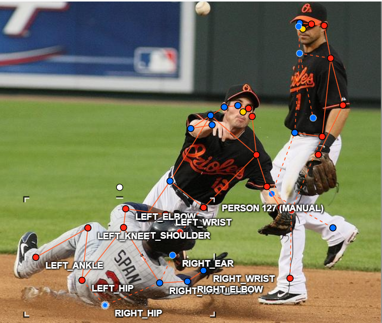

# Báo cáo cá nhân — DaoDuyHieu - 2A202603235

## 0. Thông tin học viên

- Họ tên: Đào Duy Hiếu
- MSSV: 2A202603235
- Email:26ai.hieudd2@vinuni.edu.vn
- Link repository: https://github.com/HIEU2460/K5-L2-DAY04-DaoDuyHieu-2A202603235-KeypointPose
- Phiên bản CVAT (Help → About):
- Máy: hệ điều hành RAM  8GB · chạy CVAT chế độ lite
- Bộ ảnh (`src/exports/assignment.json` do `lab.py setup` tạo): có
- Giờ bắt đầu: 16:45
- Giờ kết thúc: 19:30

## 1. Kiểm tra label (CP0)

| Label | Kiểu | Số điểm | Tên điểm đúng bảng của lab? | Đúng thứ tự? | Số cạnh |
|---|---|---:|---|---|---:|
| `person` |Skeleton|17|có|có|19|
| `face` |Skeleton|13|Có|có|15|

Mẫu `person` dựng theo người quay mặt về camera (các điểm `left_*` nằm bên phải khung mẫu)? Trả lời: Có

Cách đổi cờ `occluded` / `outside` cho **một điểm** trên phiên bản CVAT này (một câu):
Trả lời: Chọn đúng điểm con trong Skeleton, sau đó sử dụng thao tác Occluded hoặc Outside tương ứng, kiểm tra trạng thái của điểm và lưu annotation.

## 2. Số lượng đã gán và thời gian (CP1, CP2)

| Nhóm ảnh | Số ảnh | Số skeleton đã gán | Số người dưới 60 px (không gán) | Số poster / gương / màn hình bỏ qua | Thời gian (phút) |
|---|---:|---:|---:|---:|---:|
| `easy` | 4 | 4 | 0 | 0 | 90 |
| `occluded` | 4 | 6 | 0 | 0 | 30 |
| `back` | 3 | 5 | 0 | 0 | 30 |
| `small` | 1 | 2 | 7 | 0 | 30 |
| `crowd` | 0 | 0 | 0 | 0 | 0 |
| `faces` | 8 | 8 | — | 0 | 30 |

- Số ảnh người đã xong ở mốc phút 105: 4 / 12
- Thời gian thực tế (phút): CP1 ___ · CP2 ___ · CP3 ___
- Ảnh tốn thời gian nhất là ảnh nào, vì sao?
Trả lời: ảnh tốn thời gian nhất là ảnh 000000572411.jpg, vì có nhiều người cùng chung 1 ảnh, những người trong ảnh ngồi xa khiến hình bị mờ và ngồi với tư thế khó có thể gán.

## 3. Bảng ca khó (CP1, CP2)

| Ảnh | Người / mặt | Điểm | Cờ đã chọn | Phân vân giữa | Lý do chọn |
|---|---|---|---:|---|---|
|000000030960.jpg|Người #2 |left_ankle|V=0|V=0/V=2|Điểm nằm ngoài ảnh nên chuyển sang outside|
|face_294580.jpg| Mặt #1 | eye_upper, eye_lower | V = 1 | v=1 / v=0 | Kính che vùng mắt, cần đánh giá khả năng xác định vị trí mí mắt. |
| 000000332273.jpg | Người #3 | left_ankle, right_ankle | V = 2| left / right | Tư thế chân khiến việc phân biệt trái và phải khó hơn. |

## 4. Bảng tự review (CP3)

Đi từ ảnh cuối về ảnh đầu. 5 ảnh người (ít nhất 2 ảnh `back` hoặc `crowd`) và 3 ảnh mặt. Ít nhất 8 dòng, kể cả dòng `ok`. Ghi lỗi trước, sửa sau.

Mã lỗi dùng đúng một trong: `lr_swap`, `vis_flag`, `position`, `missing`, `extra`, `ok`.

| Ảnh | Người / mặt | Điểm | Mã lỗi | Ghi chú | Đã sửa? |
|---|---|---|---|---|---|
| | | | | | |
| | | | | | |
| | | | | | |
| | | | | | |
| | | | | | |
| | | | | | |
| | | | | | |
| | | | | | |

Tổng hợp số lỗi theo mã:

| `lr_swap` | `vis_flag` | `position` | `missing` | `extra` | `ok` |
|---:|---:|---:|---:|---:|---:|
| | | | | | |

Điểm còn phân vân giữa `v = 1` và `v = 0` (ghi cả hai lựa chọn và lý do chọn):

...

## 5. Kiểm file xuất và kết quả tự kiểm (CP4)

Tự kiểm tay trong file JSON:

| File | Người / mặt kiểm (ảnh, thứ tự) | Số phần tử `keypoints` | Điểm `outside` ra `v = 0`, `occluded` ra `v = 1`? | `num_keypoints` khớp? |
|---|---|---:|---|---|
| `HoVaTen_persons.zip` | | | | |
| `HoVaTen_persons.zip` | | | | |
| `HoVaTen_faces.zip` | | | | |

Sau khi xuất, CVAT ghi `occluded` thành `v = ___` và `outside` thành `v = ___`. Tọa độ của điểm `outside` trong file là `0, 0` hay tọa độ cũ? ___

Hai job đã chuyển sang completed trên CVAT? Có / Không

Dán phần **TÓM TẮT** in ra từ `src/check_submission.py`:

```text
(dán ở đây)
```

Các `[CẢNH BÁO]` còn giữ nguyên và lý do:

...

## 6. Ảnh chụp màn hình

1. Label `person` trong label constructor (đủ 17 điểm có tên):

   

2. Một người quay lưng đã gán, cờ đã đặt:

   

3. Một khuôn mặt đã gán 13 điểm, phóng to vùng mắt:

   

4. Một đoạn JSON xuất của một người:

   

Nguồn ảnh: COCO val2017 / Wikimedia Commons.

## 7. Tự đánh giá

1. Lỗi bạn mắc nhiều nhất hôm nay, và cách bạn sẽ tránh ở dự án thật:

   ...

2. Một quy tắc bạn đề xuất thêm vào guideline (kèm ảnh ví dụ nếu có):

   ...

3. Nhãn của bạn đi vào model ở đâu? Chọn một lỗi bạn đã sửa và nói nó sẽ làm model học sai thế nào (heatmap, trọng số trong loss, hay bước lật ảnh):

   ...

## 8. Khó khăn và lỗi kỹ thuật

...

## Bonus (nếu làm)

### B1 — 3 ảnh người khó thêm

| Ảnh | Số skeleton | Số người dưới 60 px | Ca khó nhất |
|---|---:|---:|---|
| | | | |
| | | | |
| | | | |

Kết quả `src/check_submission.py` cho `HoVaTen_bonus_persons.zip`:

```text
(dán ở đây)
```

### B2 — 5 ảnh khuôn mặt đen trắng / hồng ngoại

Ảnh không màu khó hơn ở điểm nào? Kính râm trên ảnh hồng ngoại có còn là `v = 1` không?

...

### B3 — Model so với nhãn của tôi (không tính điểm)

- Demo đã dùng:
- Ảnh đã thử:

1. Model có trả điểm cho khớp bị che, hay khớp ngoài ảnh không? Confidence ở các điểm đó thế nào?

   ...

2. Với người quay lưng, model có đổi trái/phải không?

   ...

3. Bộ điểm của model có giống 17 điểm COCO không?

   ...

## 9. Tài liệu tham khảo và công cụ AI đã dùng

...
